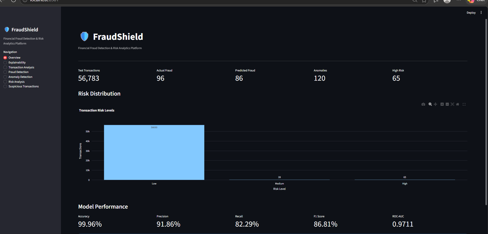
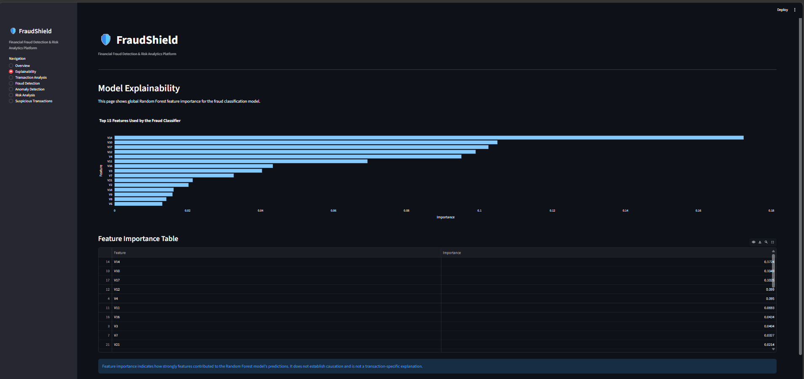
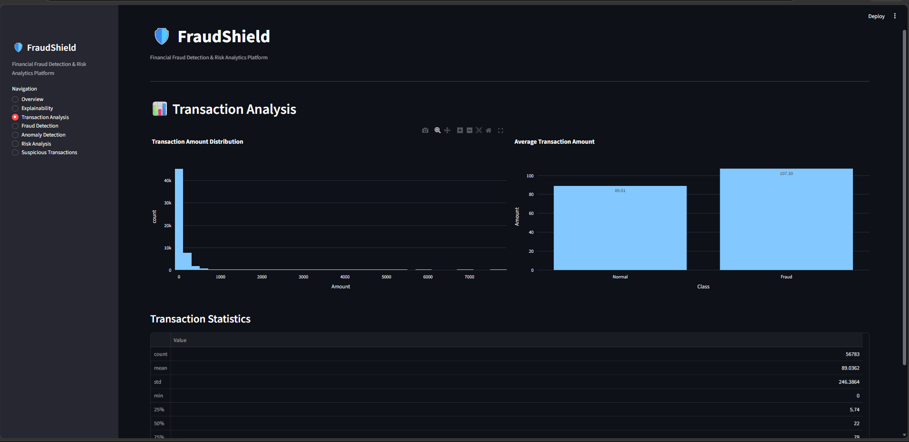
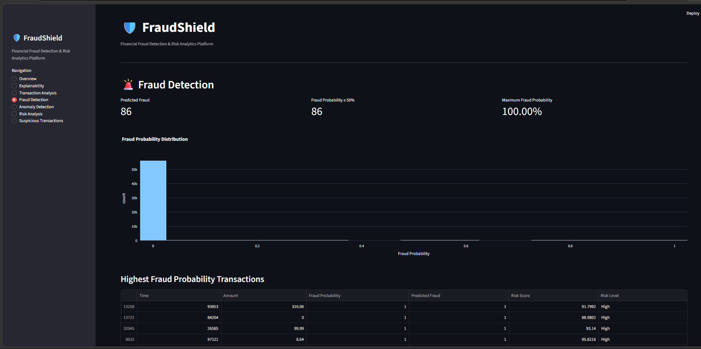
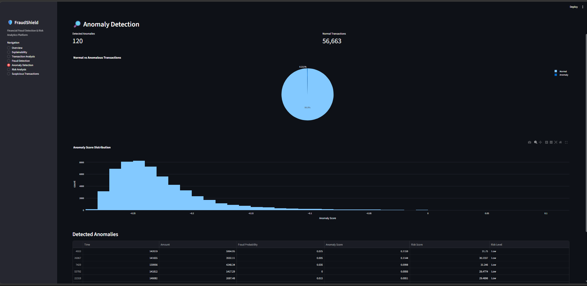
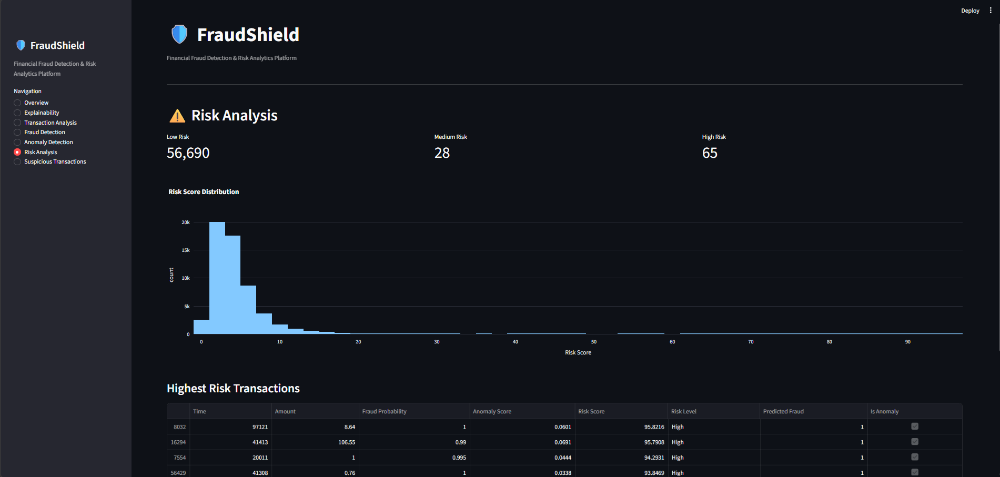
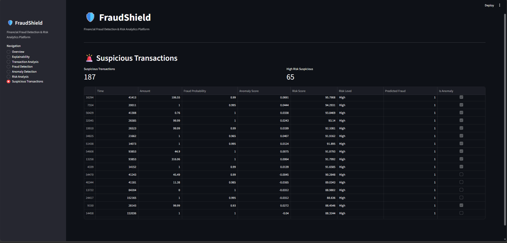

# 🛡️ FraudShield — Financial Fraud Detection & Risk Analytics Platform

FraudShield is an end-to-end financial fraud detection and risk analytics platform built with Python, Machine Learning, and Streamlit.

The system combines supervised fraud classification, unsupervised anomaly detection, risk scoring, model evaluation, explainability, and interactive analytics into a single dashboard.

---

## 🚀 Project Overview

Financial fraud detection is a highly imbalanced machine-learning problem where fraudulent transactions represent only a small fraction of total transactions.

FraudShield addresses this problem through a multi-stage analytics pipeline:

```text
Transaction Dataset
        ↓
Data Validation & Cleaning
        ↓
Exploratory Data Analysis
        ↓
Feature Engineering
        ↓
Fraud Classification
        ↓
Anomaly Detection
        ↓
Risk Scoring
        ↓
Model Evaluation
        ↓
Explainability
        ↓
Interactive Streamlit Dashboard
```

---

## 🎯 Key Objectives

- Detect potentially fraudulent transactions
- Identify unusual transaction behavior
- Combine fraud probability and anomaly signals into a risk score
- Evaluate fraud detection using appropriate classification metrics
- Provide interpretable model-level feature importance
- Present results through an interactive dashboard
- Maintain a leakage-aware evaluation methodology

---

## 🧠 Machine Learning Approach

### 1. Fraud Classification

FraudShield uses a **Random Forest Classifier** for supervised fraud detection.

The classifier produces:

- Fraud probability
- Predicted fraud label
- Precision
- Recall
- F1 score
- ROC-AUC
- Confusion matrix

Class imbalance is addressed using:

```text
class_weight = "balanced"
```

---

### 2. Anomaly Detection

An **Isolation Forest** is used to identify unusual transaction patterns independently of the fraud classifier.

> An anomaly is not automatically a fraud transaction.

The anomaly detector provides an additional behavioral signal that is combined with the supervised fraud prediction.

---

### 3. Risk Scoring

Fraud probability and anomaly score are combined into a normalized **0–100 Risk Score**.

Risk levels:

```text
0–39   → Low
40–69  → Medium
70–100 → High
```

The risk score is intended as an analytical prioritization signal rather than a definitive fraud decision.

---

## 🔧 Feature Engineering

Additional transaction-level features include:

- `Hour`
- `Amount_Log`
- `Amount_Per_Time`
- `Time_Delta`

These features complement the original transaction attributes provided by the dataset.

---

## 📊 Evaluation

FraudShield uses a **duplicate-aware, leakage-free evaluation strategy**.

The original dataset contains duplicate feature rows. Instead of allowing identical feature rows to appear in both training and testing sets, exact duplicate feature rows are removed from the evaluation dataset before the train/test split.

### Final Verified Evaluation

| Metric | Result |
|---|---:|
| Accuracy | **99.96%** |
| Fraud Precision | **91.86%** |
| Fraud Recall | **82.29%** |
| Fraud F1 | **86.81%** |
| ROC-AUC | **0.9711** |

### Confusion Matrix

```text
                Predicted
              Normal  Fraud

Actual Normal   56680     7
Actual Fraud       17    79
```

The evaluation test set contained:

- 56,783 unique transactions
- 96 fraud transactions
- 79 correctly detected fraud transactions
- 17 missed fraud transactions
- 7 false fraud alerts

> These results are specific to the selected ULB Credit Card Fraud Detection dataset and the documented evaluation split. They should not be interpreted as real-world banking performance.

---

## 🔍 Model Explainability

FraudShield includes a model explainability page showing **global Random Forest feature importance**.

The feature importance visualization helps identify which input variables contributed most strongly to the trained model's predictions.

> Feature importance indicates model behavior; it does not establish causation and is not a transaction-specific explanation.

---

## 📊 Interactive Dashboard

The Streamlit dashboard contains:

### Overview

- Test transaction count
- Actual fraud count
- Predicted fraud count
- Detected anomalies
- High-risk transactions
- Risk distribution
- Model performance

### Model Explainability

- Top 15 feature importance
- Feature importance table

### Transaction Analysis

- Transaction amount distribution
- Average amount comparison
- Transaction statistics

### Fraud Detection

- Fraud probability distribution
- Highest-probability transactions
- Predicted fraud analysis

### Anomaly Detection

- Normal vs anomaly distribution
- Anomaly score distribution
- Detected anomaly table

### Risk Analysis

- Low / Medium / High risk distribution
- Risk score distribution
- Highest-risk transactions

### Suspicious Transactions

Transactions flagged by either:

- Fraud classifier
- Anomaly detector

---

## 🧪 Automated Testing

FraudShield includes automated tests using `pytest`.

Current verification:

```text
10 passed
```

Test coverage includes:

- Dataset loading
- Dataset validation
- Data cleaning
- Feature engineering
- Model construction
- Train/test splitting
- Anomaly detection
- Risk scoring
- Evaluation metrics
- Generated report validation

Run tests with:

```bash
python -m pytest -q
```

---

## 🏗️ Project Structure

```text
FraudShield/
├── data/
│   ├── raw/
│   └── processed/
├── src/
│   ├── data_loader.py
│   ├── preprocessing.py
│   ├── eda.py
│   ├── feature_engineering.py
│   ├── fraud_detection.py
│   ├── anomaly_detection.py
│   ├── risk_scoring.py
│   ├── evaluation.py
│   ├── pipeline.py
│   └── train_fraud_model.py
├── app/
│   └── app.py
├── models/
├── reports/
├── screenshots/
├── tests/
│   └── test_basic.py
├── README.md
├── requirements.txt
└── .gitignore
```

---

## 🛠️ Technologies

- Python
- Pandas
- NumPy
- Scikit-learn
- Matplotlib
- Seaborn
- Plotly
- Streamlit
- Imbalanced-learn
- Joblib
- Pytest

---

## 📚 Dataset

FraudShield uses the **ULB Credit Card Fraud Detection** dataset.

The dataset contains:

- 284,807 transactions
- 492 fraudulent transactions
- 28 anonymized PCA features (`V1`–`V28`)
- Transaction time
- Transaction amount
- Binary fraud label

Fraud represents approximately **0.173%** of the original dataset, making this a highly imbalanced classification problem.

The original raw dataset is not included in the GitHub repository.

---

## ⚠️ Limitations

This project is an educational and portfolio-oriented fraud analytics platform.

Important limitations include:

- The dataset contains anonymized PCA features.
- The evaluation is based on a historical public dataset.
- Model performance may not generalize to real banking environments.
- Fraud patterns can change over time.
- Anomaly detection does not mean fraud detection.
- Feature importance does not establish causality.
- The risk score is an analytical prioritization mechanism, not a financial decision system.
- Real-world deployment would require additional monitoring, calibration, privacy controls, security controls, and continuous retraining.

---

## ▶️ Local Setup

Clone the repository:

```bash
git clone https://github.com/mdsakibhasan-cs/FraudShield.git
cd FraudShield
```

Create a virtual environment:

```bash
python -m venv .venv
```

Install dependencies:

```bash
pip install -r requirements.txt
```

Place the dataset at:

```text
data/raw/creditcard_dataset/creditcard.csv
```

Run the test suite:

```bash
python -m pytest -q
```

Run the Streamlit dashboard:

```bash
python -m streamlit run app/app.py
```

---

## 🚀 Live Demo

**Try FraudShield live:**

[](https://fraudshield-financial-fraud-analytics.streamlit.app/)

**Live Application:**  
https://fraudshield-financial-fraud-analytics.streamlit.app/

---

## 📸 Dashboard Screenshots

### Overview



### Explainability



### Transaction Analysis



### Fraud Detection



### Anomaly Detection



### Risk Analysis



### Suspicious Transactions



---

## 📌 Project Status

**Completed — Portfolio Project**

FraudShield demonstrates an end-to-end workflow combining:

**Data Science + Machine Learning + Fraud Analytics + Anomaly Detection + Explainability + Software Engineering**

---

## 👨‍💻 Author

**Md Sakib Hasan**

Computer Science & Technology  
Nantong University

Interests:

- Cyber Security
- Data Science
- Machine Learning
- Artificial Intelligence
- Software Engineering